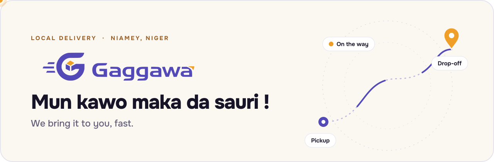
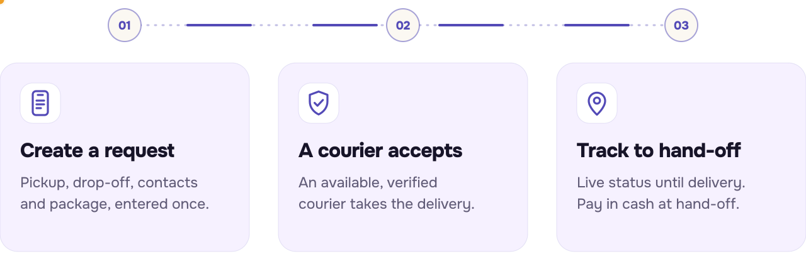
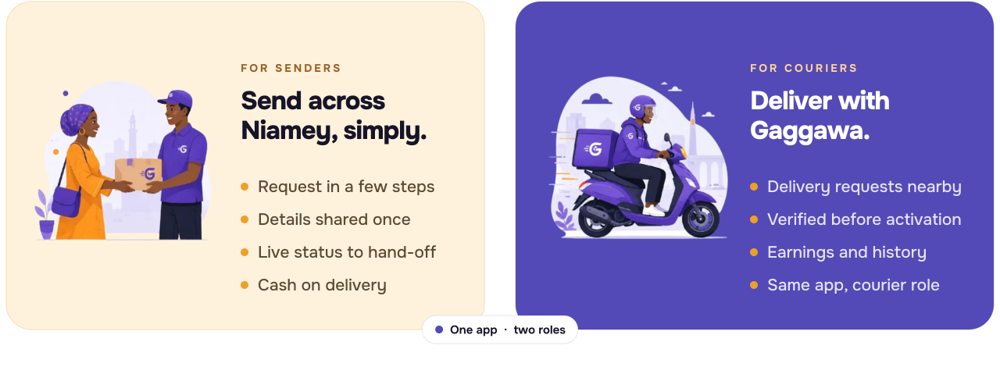
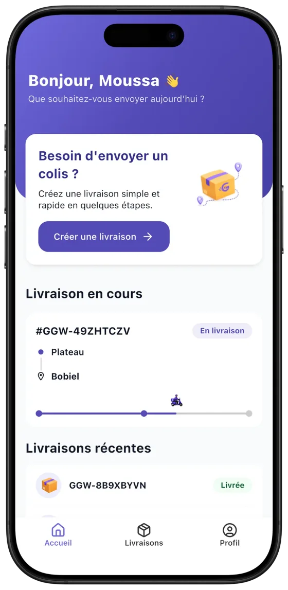
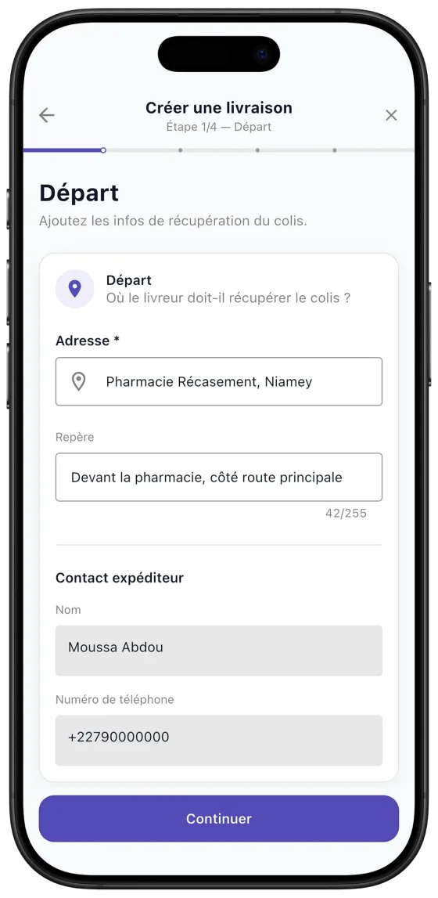

<picture>
  <source media="(prefers-color-scheme: dark)" srcset="assets/banner-dark.svg">
  <source media="(prefers-color-scheme: light)" srcset="assets/banner-light.svg">
  
</picture>

  <b>Package delivery in Niamey, without the back-and-forth.</b> 
  One mobile app to request a delivery, connect with a verified courier and follow it until hand-off.

  <a href="https://www.gaggawa.com"><b>gaggawa.com</b></a>
  &nbsp;·&nbsp;
  <a href="mailto:contact@gaggawa.com">contact@gaggawa.com</a>

## About Gaggawa

Sending a package across Niamey often means calling around for an available courier, repeating the address several times, then chasing updates. Gaggawa replaces that with a single request: the details are entered once, a verified courier takes the delivery, and its status stays visible until hand-off.

Gaggawa is built for individuals, shops and small businesses that send things across the city, and for couriers looking for a more structured way to find delivery work.

> **Mun kawo maka da sauri !** — Hausa for *“We bring it to you, fast.”*

## How it works

<picture>
  <source media="(prefers-color-scheme: dark)" srcset="assets/how-it-works-dark.svg">
  <source media="(prefers-color-scheme: light)" srcset="assets/how-it-works-light.svg">
  
</picture>

## The product

<picture>
  <source media="(prefers-color-scheme: dark)" srcset="assets/product-dark.svg">
  <source media="(prefers-color-scheme: light)" srcset="assets/product-light.svg">
  
</picture>

  
  &nbsp;&nbsp;&nbsp;
  

Screens from the current client app, shown with demo data.

Senders and couriers use the same Gaggawa app and choose their role at sign-up. Courier accounts are reviewed before they can accept deliveries.

## Status

**Pre-launch.** Gaggawa is getting ready to launch in Niamey. The app is not yet listed on the App Store or Google Play — availability will be announced on [gaggawa.com](https://www.gaggawa.com).

## Get in touch

For partnerships, press or general questions, write to [contact@gaggawa.com](mailto:contact@gaggawa.com).

  
   
  © 2026 Gaggawa · Proprietary product — the source code is not public.

